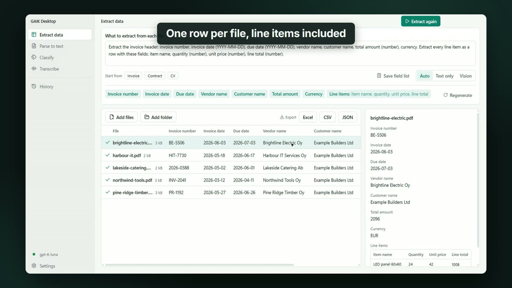

# GAIK Desktop (experimental)

A desktop app for the [GAIK Toolkit](https://github.com/GAIK-project/gaik-toolkit). Drop
files or a whole folder, and the toolkit runs on your own computer:

- **Extract data**: describe the fields in your own words, get one row per file, export
  to Excel, CSV or JSON. Repeated groups such as invoice lines become their own sheet.
- **Parse to text**: PDF and Word to text without a model; scans and images through your
  model.
- **Classify**: give your classes, get a class, a confidence and a reason per file.
- **Transcribe**: audio and video to text, with an optional correction pass.

[](docs/demo.mp4)

A 50-second demo ([docs/demo.mp4](docs/demo.mp4)): real model calls on made-up sample
documents, with the waits for the model shortened. No sound.

Files are read where they are. Nothing is uploaded to a GAIK server: only the text or page
images of a document go to the model provider you configure (Azure OpenAI or OpenAI), with
your own key. Finished runs are kept in a local history.

This is an experiment, not a supported product: there is no signed installer and no
auto-update, and it has been tried on Windows 11 only.

## run it

Needs [bun](https://bun.sh) and [uv](https://docs.astral.sh/uv/).

```bash
bun install
```

```bash
bun start
```

The first start installs the engine (Python and `gaik` from PyPI, about 300 MB) into the
app's data folder; later starts take a few seconds. Then open **Settings** and enter your
model endpoint and key. Parsing documents that have a text layer works without a key.

`bun run pack` builds an unpacked app into `release/`, `bun run dist` an installer for the
current platform. The packaged app still needs `uv` on the computer for the first start.

## how it works

```
Electron main process (src/)      window, settings, file pickers, engine lifecycle
 ├─ renderer (renderer/)          React + Tailwind, no Node access, talks through a preload bridge
 └─ engine (sidecar/server.py)    FastAPI over gaik, 127.0.0.1 on a free port, per-run token
```

- The engine runs `gaik` 0.9.0 with CPU-only extras (no torch). Requests name files by
  path, so documents are never copied.
- Model keys are encrypted with the operating system's secure storage (Electron
  `safeStorage`) and handed to the engine as environment variables. The settings page
  never receives a saved key back.
- **Other environment variables** in Settings accepts any `KEY=VALUE` that gaik reads, for
  example `LLM_PROVIDER=aitta` with `AITTA_API_KEY` for CSC Aitta.

## limits

- Transcription needs an OpenAI or Azure OpenAI speech-to-text deployment
  (`gpt-4o-transcribe` by default); long recordings also need `ffmpeg` on your `PATH`.
- A description is turned into a field list by the toolkit's `SchemaGenerator`, and the
  same description can come back with fewer fields (in testing, one run in four dropped
  line-item fields). The app shows the fields before any file is read; use **Regenerate**
  when one is missing, and **Save field list** to reuse a good list exactly as it is.
- macOS and Linux builds are untested.

## development

```bash
bun run check
```

runs the syntax checks, the unit tests of the settings and file logic, and the type
check. The engine has a live smoke test that makes real model calls:

```bash
python sidecar/smoke_live.py
```

(run it with the engine's Python and your provider variables in the environment).
`GAIK_DESKTOP_USE_ENV=1 bun start` makes the engine use the model variables of the shell
instead of the settings page.

`GAIK_DESKTOP_RECORD_DIR=<folder>` renders the window offscreen and writes every painted
frame to that folder, for demo recordings that do not depend on the desktop being visible;
drive the app over `--remote-debugging-port`.

## license

MIT, like the GAIK Toolkit.
